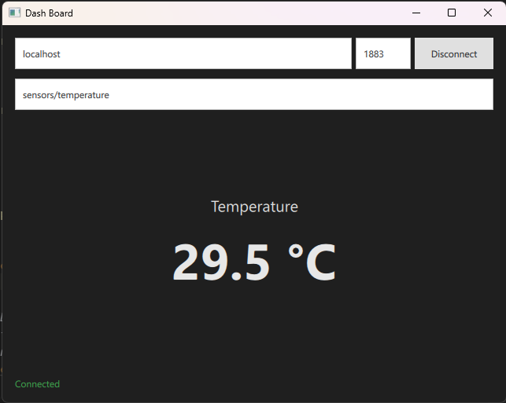

# Qt Sensor Dashboard



A small Qt 6 desktop dashboard that connects to an MQTT broker and displays the latest temperature value from a configured topic.

The app includes a simple control panel for the broker hostname, port, and MQTT topic, plus a live temperature readout and connection status. It accepts either a plain numeric payload such as `29.5` or a JSON payload like `{"temperature": 29.5}`.

## Features

- Connect or disconnect from an MQTT broker
- Enter broker host, port, and topic dynamically
- Subscribe to a temperature topic
- Display the latest temperature in Celsius
- Show connection state and status text
- Support both light and dark UI themes

## Project structure

- `Main.qml` — user interface and dashboard layout
- `main.cpp` — Qt application entry point
- `temperatureclient.h` — MQTT temperature client declaration
- `temperatureclient.cpp` — MQTT connection, subscription, and payload parsing logic
- `CMakeLists.txt` — CMake configuration for the Qt project

## Requirements

- Qt 6.8 or newer
- CMake 3.16 or newer
- Qt MQTT module (`Qt6::Mqtt`)
- An MQTT broker such as Mosquitto

## Build

From the project root:

```bash
cmake -S . -B build
cmake --build build
```

On Windows, if Qt is installed in a custom location, make sure the Qt environment is configured before running CMake.

## Run

After building, run the generated application from the build output directory. For example:

```bash
./build/appQtSensorDash
```

or on Windows:

```powershell
.\build\appQtSensorDash.exe
```

## MQTT usage

The default settings are:

- Broker: `localhost`
- Port: `1883`
- Topic: `sensors/temperature`

You can publish sensor data to the topic with either:

```text
29.5
```

or:

```json
{"temperature": 29.5}
```

## Notes

This project is intended as a lightweight dashboard for monitoring a temperature sensor over MQTT and is easy to extend for additional sensor values or richer dashboard widgets.
